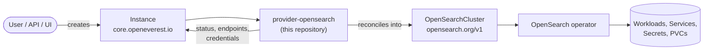

# OpenSearch Provider

> [!WARNING]
> **Pre-alpha.** OpenEverest v2 and this provider are under active development. CRD schemas,
> chart values and defaults change frequently, including in breaking ways, and there is no
> supported upgrade path between versions yet. Not for production use.

<!-- TODO(sdk): remove the pre-alpha banner and the status badge at v2 GA. -->

[](https://github.com/openeverest/openeverest)
[](https://github.com/openeverest/provider-opensearch/actions/workflows/ci.yaml)
[](https://github.com/openeverest/provider-opensearch/releases)
[](https://pkg.go.dev/github.com/openeverest/provider-opensearch)
[](LICENSE)

Run **OpenSearch** on Kubernetes through [OpenEverest](https://github.com/openeverest/openeverest),
backed by the [OpenSearch Kubernetes Operator](https://github.com/opensearch-project/opensearch-k8s-operator).

## What this is

OpenEverest providers translate a single, technology-agnostic `Instance` custom resource into
the native custom resources of an upstream Kubernetes operator — for databases, but equally
for caches, message queues, object storage, or model-serving runtimes. This repository is the
provider for OpenSearch: it owns the technology-specific knowledge — topologies, versions,
parameters, backup wiring — so that users, the API server, and the UI stay technology-agnostic.

> [!IMPORTANT]
> **This provider is not standalone.** It requires an OpenEverest installation (core CRDs and
> controller) in the cluster. Installing this chart on its own does nothing.
> See [Install OpenEverest](https://openeverest.io/documentation/current/quick-install.html).



The provider watches `Instance` resources whose `spec.providerRef.name` is
`opensearch`, and reports workload health back onto `Instance.status`. It never
manages pods directly — all lifecycle work is delegated to the operator.

## Compatibility

| provider-opensearch | OpenEverest | OpenSearch operator | OpenSearch | Kubernetes |
|---|---|---|---|---|
| `0.3.x` | `2.0.0-alpha.1` | `3.0.x` (chart `3.0.14`) | `3.7`, `3.8` | `1.32` – `1.35` |
| `0.2.x` | `2.0.0-dev.3` | `3.0.x` (chart `3.0.14`) | `3.7`, `3.8` | `1.30` – `1.35` |
| `0.1.x` | `2.0.0-dev.3` | `3.0.x` (chart `3.0.14`) | `3.7`, `3.8` | `1.30` – `1.34` |

The OpenEverest column names exact versions: SemVer ranks `2.0.0-dev.N` above `2.0.0-alpha.N`,
so a range would also claim the older dev releases. `0.3.x` needs the class-based
`BackupStorage`, `ClusterInstancePreset`, the monitoring contract and the condition-based
Instance status of `2.0.0-alpha.1`; install it with that core on a fresh cluster, as there is
no upgrade path from `0.2.x`.

## Capabilities

What you can do to a running instance through the `Instance` API. Upgrading the
provider itself is covered under [Installation](#installation). See [ROADMAP.md](ROADMAP.md)
for what is planned next.

| Capability | Status | Notes |
|---|---|---|
| Provisioning | ✅ | `standard` and `dedicated` topologies; see [Topologies](#topologies) |
| Horizontal scaling | ✅ | `spec.components.engine.replicas` |
| Vertical scaling (CPU / memory) | ✅ | `spec.components.engine.resources`; the JVM heap is half the memory request |
| Version upgrades | ✅ | `spec.version`; the operator performs a rolling upgrade. Downgrades and jumps over more than one major version are rejected |
| Custom configuration | ✅ | `spec.components.engine.parameters.configuration`; an `opensearch.yml` fragment (YAML), merged into `additionalConfig`. Keys the provider manages (security, discovery, node, network, paths, ports) are rejected |
| External access | ✅ | `spec.components.engine.service`; annotations on the main service, `LoadBalancer`/`NodePort` via a separate `<name>-exposed` service; the certificate covers in-cluster names, plus `spec.parameters.tls.additionalNames` with an issuer |
| Dashboards | ✅ | Optional `dashboards` component; see [Configuration](#configuration) |
| Monitoring | ✅ | Metrics for ExtensionManaged monitoring classes (Prometheus, VictoriaMetrics, …) through the Prometheus exporter plugin; see [Configuration](#configuration) |
| TLS | ✅ | Always on. The HTTP certificate is generated, or comes from a Secret or a cert-manager issuer (`spec.parameters.tls`), optionally with additional DNS names; transport certificates are always generated. See [Configuration](#configuration) |
| Custom credentials | ✅ | `spec.userSecretRef` seeds the `admin` password at creation; see [Configuration](#configuration) |

Stateful workloads additionally report:

| Capability | Status | Notes |
|---|---|---|
| Persistent storage | ✅ | `spec.components.engine.storage` (and `clusterManager.storage` in `dedicated`); volumes are deleted with the Instance |
| Storage expansion | ✅ | `spec.components.<component>.storage.size`; rejected when the StorageClass does not allow expansion |
| Disruption budget | ✅ | A `PodDisruptionBudget` lets node drains evict one OpenSearch node at a time; see [Configuration](#configuration) |
| Backups (on demand) | ✅ | S3-compatible storage, via the OpenSearch snapshot API; see [Configuration](#configuration) |
| Backups (scheduled) | ✅ | `spec.backup.storages[].schedules[]`; see [Configuration](#configuration) |
| Restore | ✅ | In place, or seeding a new Instance via `spec.dataSource`; see [Configuration](#configuration) |

## Installation

The provider chart is published as an OCI artifact:

```bash
helm install provider-opensearch \
  oci://ghcr.io/openeverest/charts/provider-opensearch \
  --version <chart-version> \
  --namespace everest-system
```

- The OpenSearch operator (and its CRDs) is bundled as a chart dependency and is installed
  automatically. Set `operator.enabled=false` if the operator is already installed.
- The operator's validating webhooks are disabled by default because they require
  cert-manager; enable `operator.webhook.enabled` and `operator.webhook.certManager.enabled`
  together if cert-manager is available. The provider's own Instance admission webhook
  (installed by the chart, no cert-manager needed) rejects the same unsafe changes (version
  downgrades, upgrades that skip a major version, storage class changes, shrinking storage)
  without them, so enabling the operator's webhooks is defense-in-depth, not a requirement.
  Set `admission.certManager.enabled=true` to have cert-manager issue the provider webhook's
  certificate instead of the chart.
- The chart installs a `ClusterInstancePreset` per topology, `opensearch-standard` and
  `opensearch-dedicated`, with the UI's default sizes on the default version. Change or disable
  them under `presets` in the chart values. Presets are cluster-scoped, so they reference no
  Secrets or backup storages; teams publish their own as namespaced `InstancePreset`s.

Upgrade and uninstall:

```bash
helm upgrade provider-opensearch oci://ghcr.io/openeverest/charts/provider-opensearch
helm uninstall provider-opensearch --namespace everest-system
```

A `helm upgrade` first runs a preflight Job with the new provider image. It aborts the upgrade
when an `OpenSearchCluster` is in the middle of a version upgrade or a rolling restart, or when
the installed release is older than the new release's `minUpgradableFrom`. A cluster that is
not running or not green only produces a warning. The report is in the Job's log, which Helm
keeps when the hook fails:

```bash
kubectl logs -n everest-system job/provider-opensearch-preflight
```

A provider upgrade can change how an existing cluster is rendered: new defaults, or a new
image for a version bundle. That change restarts the nodes one by one, so it is held as a
`RollingRestart` maintenance action and listed in the Instance's `status.pendingMaintenance`
until it is approved:

```bash
kubectl get instance my-search -o jsonpath='{.status.pendingMaintenance}'
kubectl patch instance my-search --type merge \
  -p '{"spec":{"maintenance":{"approved":"<approvalToken>"}}}'
```

Set `spec.maintenance.autoApproveUpTo: RollingRestart` to apply such changes without asking. A
change to the Instance itself applies right away, together with any held change. Two cases are
not held:

- A cluster last reconciled by a provider release without maintenance gating has no record
  of what was applied yet. Its first reconcile after the upgrade applies the new rendering
  and records it.
- A newer bundled OpenSearch operator may restart the nodes on its own, without any change
  from the provider. Upgrade the provider in a maintenance window when the release notes
  mention an operator upgrade.

Uninstalling the chart does **not** delete running `Instance` resources or their data.

## Usage

Verify that the provider registered itself:

```bash
kubectl get providers.core.openeverest.io opensearch
```

Create an instance:

```yaml
apiVersion: core.openeverest.io/v1alpha1
kind: Instance
metadata:
  name: my-instance
spec:
  providerRef:
    name: opensearch
  components:
    engine:
      replicas: 3
      resources:
        limits:
          cpu: "1"
          memory: 4Gi
      storage:
        size: 10Gi
```

Component names are defined by this provider — see [definition/provider.yaml](definition/provider.yaml).
`spec.version` and `spec.topology` are optional; the provider defaults apply.
More examples live in [examples/](examples/).

Watch it come up and read the connection details:

```bash
kubectl get instance my-instance -w
kubectl get secret "$(kubectl get instance my-instance -o jsonpath='{.status.connectionSecretRef.name}')" -o yaml
```

The connection secret holds the HTTPS endpoint (`host`, `port`, `uri`) of the cluster's
client service (`<instance>` or, in the `dedicated` topology, `<instance>-client`), the `admin` user's credentials and
`ca.crt`, the CA that verifies the endpoint. Unless [custom TLS](#configuration) is set, the HTTP certificate is signed by a CA
the operator generates per cluster (secret `<instance>-ca`).

## Topologies

<!-- TODO(sdk): these blocks are hand-maintained until `provider-sdk generate` fills them
     from definition/. Until then, update them whenever definition/ changes. -->

<!-- BEGIN GENERATED: topologies -->
| Topology | Default | Description |
|---|---|---|
| `standard` | ✅ | One node pool (`engine`); every node is cluster-manager eligible, holds data and runs ingest pipelines. 3 nodes by default |
| `dedicated` | | One node pool per role: `clusterManager` (3 by default), `engine` as data + ingest nodes (3 by default), and optional coordinating-only `coordinator` nodes (2 by default, no storage) |
<!-- END GENERATED: topologies -->

The topology is chosen at creation and cannot be changed afterwards. Choose `dedicated` for
larger clusters: the cluster-manager quorum keeps working while data nodes are busy or
restarting, and coordinators take request routing and result merging off the data nodes.

```yaml
spec:
  topology:
    type: dedicated
  components:
    clusterManager:
      replicas: 3
      resources: {limits: {cpu: "1", memory: 2Gi}}
      storage: {size: 5Gi}
    engine:
      replicas: 3
      resources: {limits: {cpu: "2", memory: 8Gi}}
      storage: {size: 100Gi}
    coordinator:  # optional
      replicas: 2
      resources: {limits: {cpu: "1", memory: 4Gi}}
```

In the `dedicated` topology:

- `clusterManager.replicas` must be odd; a single cluster manager is allowed with a warning,
  since the cluster stops accepting writes while it restarts.
- Clients connect to the `<instance>-client` service, which is in the HTTP certificate. It
  routes to the coordinators when there are any, else to the data nodes, so adding or
  removing `coordinator` does not change the connection details. `engine.service` exposes
  the same nodes.
- Each OpenSearch component takes its own `parameters.configuration`, applied to its nodes
  only.
- Storage size and class rules apply to `clusterManager` and `engine` alike.

## Versions

<!-- BEGIN GENERATED: versions -->
| Version bundle | Default | opensearch |
|---|---|---|
| `3.8.0` | ✅ | `3.8.0` |
| `3.7.0` | | `3.7.0` |
<!-- END GENERATED: versions -->

Source of truth: [definition/versions.yaml](definition/versions.yaml).

Change `spec.version` on a running Instance, or pick a newer version when editing it in the UI,
to upgrade it. The operator performs a rolling upgrade and the Instance reports `Updating` until
every node runs the new version; Dashboards moves to the same bundle. Admission rejects
downgrades and upgrades that skip a major version.

## Configuration

- **Chart values:** [charts/provider-opensearch/values.yaml](charts/provider-opensearch/values.yaml)
- **Instance parameters:** per-component and per-topology `parameters` schemas, defined under
  [definition/](definition/) and published on the `Provider` resource
  (`kubectl get provider opensearch -o yaml`). The API server and the UI validate
  user input against these schemas.

Worth knowing:

- **Memory** — the operator gives the JVM half of the memory request as heap. Requests default
  to the limits when only limits are set; the minimum is `2Gi`.
- **Instance name** — at most 36 characters, since the operator derives Kubernetes object
  names from it.
- **Storage class** — cannot be changed after creation. A size increase is rejected if the
  class's `allowVolumeExpansion` is not `true`.
- **Rolling restarts** — changing the version, resources, custom configuration, or enabling
  backups restarts the nodes one by one. Restarts the user asks for are applied right away;
  `spec.maintenance` holds only the ones a provider upgrade causes (see
  [Installation](#installation)). Scaling and Dashboards changes do
  not restart the OpenSearch nodes.
- **Version changes** — downgrades and upgrades that skip a major version are rejected; see
  [Versions](#versions).
- **Custom configuration** — `spec.components.engine.parameters.configuration` takes an
  `opensearch.yml` fragment, flattened into dotted keys (nested YAML is flattened the same
  way, e.g. `cluster: {routing: {allocation: {disk: {threshold_enabled: false}}}}` becomes
  `cluster.routing.allocation.disk.threshold_enabled`). List-valued keys are rejected, as are
  the keys the provider and operator manage: `plugins.security.*` (TLS and the security
  plugin), `discovery.*`, `cluster.name`, `cluster.initial_*`, `node.*`, `network.*`, `path.*`,
  and the HTTP and transport ports. A change restarts the nodes one by one; the Instance is
  `Updating` until the restart finishes.
- **External access** — the OpenSearch operator's own service is always `ClusterIP`; it has no
  field to change that. Setting `spec.components.engine.service.serviceType` to `LoadBalancer`
  or `NodePort` makes the provider create and manage a second service, `<name>-exposed`,
  pointing at the same pods, exposing only the REST API port (9200). Annotations
  (`service.annotations`) are applied to the operator's main service regardless of type.
  Reverting to `ClusterIP` (or unsetting `service`) removes the `<name>-exposed` service.
  Once a `LoadBalancer` has an address, the connection secret publishes it as `host`. The
  operator-generated HTTP certificate only covers the in-cluster names, so external clients
  must trust `<name>-ca` and skip hostname verification, or the Instance must use a custom
  certificate that also names the external address, such as an issuer with
  `spec.parameters.tls.additionalNames` (see TLS below).
- **Admin credentials** — set `spec.userSecretRef.name` to a Secret with a `password` key (and
  optionally `username: admin`; the operator manages only the `admin` user) to choose the
  admin password. It can only be set when the Instance is created. The provider copies the
  password once into `<name>-admin-credentials`, so later edits to your Secret do not change
  it. Without it the operator generates the password (`<name>-admin-password`).
- **TLS** — connections are always encrypted. By default the operator generates the HTTP
  (client) and transport certificates. To use your own HTTP certificate, set one of these
  when the Instance is created; neither can be changed or removed afterwards:
  - `spec.parameters.tls.certificateSecretName`: a Secret in the Instance namespace with
    `tls.crt`, `tls.key` and `ca.crt`. The key must be PKCS#8 (`BEGIN PRIVATE KEY`), which
    OpenSearch requires, and the certificate must be valid for the client host,
    `<name>.<namespace>.svc` (or `<name>-client.<namespace>.svc` in `dedicated`), with
    server auth usage, verifiable with `ca.crt`. The Instance stays `Pending` with the reason
    until the Secret qualifies.
  - `spec.parameters.tls.issuer` (`name`; `kind`: `Issuer` (default) or `ClusterIssuer`;
    `group`: `cert-manager.io` (default), or the group of an external issuer such as
    `awspca.cert-manager.io` with its own kind): the provider requests a cert-manager
    `Certificate`, `<name>-tls-http`, for the cluster's service names with a PKCS#8 key.
    cert-manager must be installed.

  `spec.parameters.tls.additionalNames` adds DNS names (no IPs; `*.` wildcards allowed) to
  the issued certificate, such as the external name clients connect to. It needs `issuer`:
  it is rejected together with `certificateSecretName`, whose certificate carries its own
  names, and with the generated certificate, which the operator issues for the in-cluster
  names only. Unlike the certificate source, the names can be changed later. OpenSearch
  does not hot-reload a certificate whose names changed, so on a running Instance a change
  is a `RollingRestart` maintenance action (`tls-names-<hash>`). Once it is approved, the
  provider updates the `Certificate`, and the nodes restart after cert-manager reissues it.
  The operator's rolling restart does not restart a 1-node Instance, as with any change that
  needs a restart: delete its pod (`<name>-nodes-0`) to serve the new names.

  Replacing the certificate in the Secret (or a cert-manager renewal with the same names) is
  picked up by the nodes without a restart. Since the operator cannot sign its admin client
  certificate with your CA, the provider keeps a CA of its own for it (`<name>-tls-admin-ca`,
  `<name>-tls-admin`) and has the nodes trust both (`<name>-tls-http-ca`). The CA that
  verifies the certificate is published as `ca.crt` in `<name>-conn`.

  **Bring your own CA.** Put your company CA in a cert-manager `ClusterIssuer`, create the
  Instance with it and the name clients use, and point that name in DNS at the
  `<name>-exposed` LoadBalancer:

  ```yaml
  apiVersion: cert-manager.io/v1
  kind: ClusterIssuer
  metadata:
    name: company-ca
  spec:
    ca:
      secretName: company-ca   # tls.crt and tls.key of the CA, in cert-manager's namespace
  ---
  apiVersion: core.openeverest.io/v1alpha1
  kind: Instance
  metadata:
    name: search
  spec:
    providerRef:
      name: opensearch
    parameters:
      tls:
        issuer:
          name: company-ca
          kind: ClusterIssuer
        additionalNames:
          - search.company.com
    components:
      engine:
        replicas: 3
        service:
          serviceType: LoadBalancer
  ```

  Clients then verify `https://search.company.com:9200` with the company CA. See
  [`examples/instance-tls-issuer.yaml`](examples/instance-tls-issuer.yaml).
- **Node drains** — every Instance gets a `PodDisruptionBudget`, `<name>-nodes-pdb`, with
  `maxUnavailable: 1`. Draining Kubernetes nodes (upgrades, autoscaler) therefore evicts one
  OpenSearch node at a time and a 3-node cluster keeps its cluster-manager quorum; a 1-node
  Instance can still be drained, with downtime. The budget counts ready pods, and a pod is
  ready once its node answers, before its shards have recovered: drain one node at a time and
  wait for green health in between. The operator's own rolling restarts and upgrades are not
  limited by it. They restart one node at a time with shard allocation limited to primaries
  (`general.drainDataNodes` stays off: moving every shard off a node before each restart would
  block restarts of a yellow cluster and need spare disk).
- **Dashboards** — an optional `dashboards` component deploys OpenSearch Dashboards as part of
  the same `OpenSearchCluster`. Supported fields: `replicas`, `resources`, and `service`
  (`serviceType`, `annotations`, `loadBalancerService.sourceRanges` — the operator supports a
  real service type for Dashboards, unlike the main engine). TLS is always generated, and the
  version always matches the engine's (admission rejects a different one). On a new Instance,
  Dashboards starts once the cluster has initialized, so it never races the cluster's first
  start. Removing the
  component removes the Dashboards deployment. There is
  no UI form field for it yet (API/CLI only), matching the only other optional-component
  precedent in the OpenEverest ecosystem. Credentials live in the
  `<name>-dashboards-password` secret.
- **Backups (on demand)** — register a `BackupStorage` of the `s3` BackupStorageClass on the
  Instance via `spec.backup.storages[]`; the provider maps it onto
  `general.snapshotRepositories` and `general.keystore` and adds `repository-s3` to
  `pluginsList` (enabling backups restarts the nodes once). Each Instance writes under its own
  path in the bucket, `<prefix>/backups/<namespace>/<instance>/<uid>/<storage>`, so Instances
  can share a `BackupStorage`. The `opensearch-snapshot` class accepts `AccessKey`
  authentication and the `aws`, `minio`, `ceph` and `other` implementations; `repository-s3`
  cannot use GCS through S3, and has no custom CA or `insecureSkipVerify` setting, so a storage
  with `spec.tls` is not compatible. A storage that cannot be used keeps the repository the
  cluster already has for it and is reported on the `BackupConfigured` condition; the other
  storages are not affected. A `Backup` CR targeting the
  `opensearch-snapshot` BackupClass then drives a real OpenSearch snapshot through the
  cluster's own REST API — the operator has no backup CR of its own. Deleting the `Backup` CR
  deletes the snapshot unless `deletionPolicy: Retain` is set.
- **Backups (scheduled)** — add entries under `spec.backup.storages[].schedules[]`; each
  enabled schedule becomes an `OpensearchSnapshotPolicy` (operator-native Snapshot Management).
  `retention` becomes a deletion condition on the same cron as creation (`count` keeps that many
  snapshots; `time` deletes older ones, a month counting as 30 days). Every minute the provider
  lists the repository, creates a `Backup` CR for each snapshot a schedule took, and deletes the
  `Backup` CRs of snapshots retention removed, so scheduled backups show up alongside on-demand
  ones.
- **Restore** — a `Restore` CR targeting a `Backup` restores the snapshot's user indices in
  place: they are closed and overwritten (same names; no rename pattern, no empty-cluster
  requirement). System indices (names starting with `.`, e.g. the security plugin's) and the
  audit-log and query-insights indices are not restored, so the cluster keeps its own users,
  roles and admin credentials. The Instance reports `Restoring` while it runs. The same path
  seeds a new Instance: set `spec.dataSource` to a `Backup` and the runtime creates the restore
  once the cluster is running. A backup of another Instance is read through a read-only
  repository at the path the `Backup` recorded, so it still resolves once the source
  Instance is gone; it needs the backup's storage in the new Instance's
  `spec.backup.storages`.
  Point-in-time recovery is not supported.
- **Monitoring** — list `MonitoringDestination`s in `spec.monitoring.destinations[]`. While a
  destination's class needs metrics (or `spec.monitoring.sources.metrics.policy` is `Always`),
  the provider installs the opensearch-project Prometheus exporter plugin of the cluster's
  version on every node, which restarts the nodes one by one, and creates a read-only
  `<name>-monitoring` user, with a role of the same name that reads the cluster's and every
  index's statistics and no documents, through `OpensearchUser`, `OpensearchRole` and
  `OpensearchUserRoleBinding`. Once every node runs the plugin, the Instance publishes
  `/_prometheus/metrics` on each node pool in `status.monitoring.sources`: HTTPS on the HTTP
  port, verified with the cluster's CA, as the monitoring user. The class's extension scrapes it;
  the provider creates no scrape object. When no destination needs metrics any more, the plugin
  and the user are removed. The plugin is downloaded from GitHub at node start, so nodes need
  egress to it. No operator-native integration (such as PMM) is supported.

## Development

Requires Go (see [go.mod](go.mod)), Docker, Helm, kubectl, and a Kubernetes cluster you can
reach. [dev/README.md](dev/README.md) covers the environment end to end: the recommended
local k3d setup, running against a cluster you already have, and every `dev/.env` setting.

```bash
make dev-up             # local cluster + Tilt dev environment (see dev/README.md)
make generate           # RBAC, provider spec, Helm chart sync
make run                # run the provider locally against the cluster
make test-unit
make test-integration   # chainsaw suites under test/integration/
make dev-down
```

`make help` lists every target. `make verify` fails when generated files are stale — run
`make generate` and commit the result.

The provider contract (`Validate` / `Sync` / `Status` / `Cleanup`), RBAC markers, watches,
code generation, and the backup/restore interfaces are documented once for all providers in
[PROVIDER_DEVELOPMENT.md](https://github.com/openeverest/provider-sdk/blob/main/PROVIDER_DEVELOPMENT.md).

### Layout

| Path | Purpose |
|---|---|
| `cmd/provider/` | Entry point |
| `internal/provider/` | `ProviderInterface` implementation, backup interfaces, RBAC markers |
| `internal/common/` | Component name constants |
| `definition/` | Provider identity, component types, versions, topologies, backup classes |
| `charts/provider-opensearch/` | Helm chart (`generated/` is produced by `make generate`) |
| `config/rbac/role.yaml` | Generated `ClusterRole` — do not edit |
| `test/integration/` | Chainsaw suites (see its `README.md`) |
| `test/vars.sh` | Pinned operator and workload versions used by tests |
| `examples/` | Example `Instance` resources |
| `dev/` | Tilt dev environment, `.env` configuration, k3d cluster config |
| `.github/workflows/` | CI: lint, build, unit and integration tests, release |

### Testing

- **Unit tests** — `make test-unit`, including the provider-runtime conformance checks
  that every UI field and supported field is consumed by `Sync`.
- **Integration tests** — chainsaw suites under `test/integration/` (operator simulated by
  patching `OpenSearchCluster` status) and `test/e2e-cluster/` (the real OpenSearch operator).
  See [test/README.md](test/README.md).
- **CI** — `.github/workflows/ci.yaml` runs lint, build, unit tests, generated-file
  verification, Helm lint, and every integration and e2e-cluster suite on every pull request.

## Troubleshooting

```bash
kubectl logs -n everest-system deploy/provider-opensearch -f
```

| Symptom | Where to look |
|---|---|
| `Instance` stuck in `Creating` | `kubectl describe instance <name>` conditions, then the provider logs |
| No `Provider` resource in the cluster | Is the chart installed? Check the provider deployment logs |
| `helm upgrade` fails with `pre-upgrade hooks failed` | `kubectl logs -n everest-system job/provider-opensearch-preflight` names the blocking Instance; wait for its upgrade or restart to finish and retry |
| `Instance` ignored entirely | `spec.providerRef.name` must be `opensearch` |
| Operator resource created but no pods | `kubectl get opensearchcluster <name> -o yaml` — the failure is upstream; check the operator logs |
| `kubectl drain` waits on `Cannot evict pod as it would violate the pod's disruption budget` | Another OpenSearch node of the Instance is not ready yet; the drain continues once it is |
| Pods crash with `max virtual memory areas vm.max_map_count` | The operator sets it through a privileged init container; the cluster's pod security settings must allow it |

## Contributing

Issues and pull requests are welcome. See
[PROVIDER_DEVELOPMENT.md](https://github.com/openeverest/provider-sdk/blob/main/PROVIDER_DEVELOPMENT.md)
and the [OpenEverest Code of Conduct](https://github.com/openeverest/openeverest/blob/main/CODE_OF_CONDUCT.md).

## Security

Report vulnerabilities per the
[OpenEverest security policy](https://github.com/openeverest/openeverest/blob/main/SECURITY.md).
Please do not open public issues for security reports.

## License

Apache License 2.0 — see [LICENSE](LICENSE) for details.
